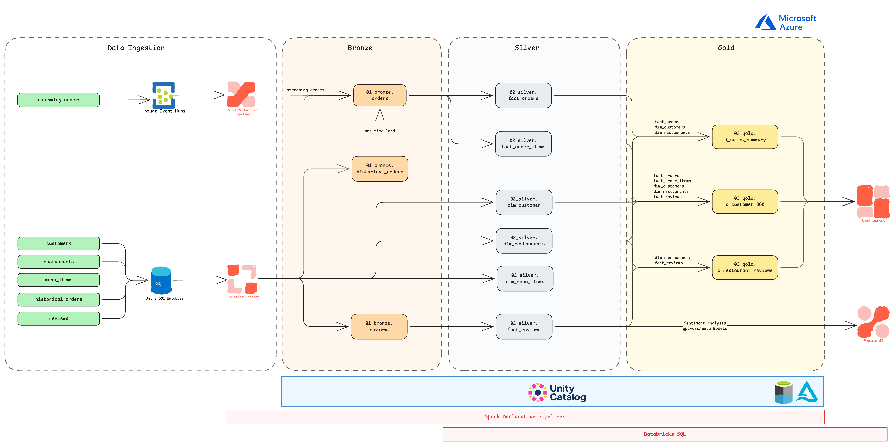
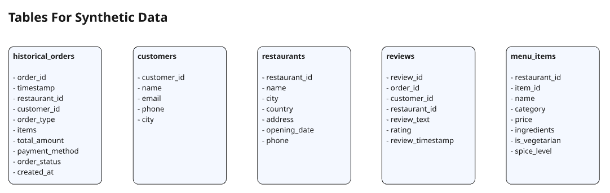

# Restaurant Lakehouse Pipeline

An end-to-end data engineering project on Databricks that implements a Lakehouse (medallion) architecture for a simulated restaurant chain. Real-time orders arrive through Azure Event Hubs (Kafka API), historical and reference data are loaded in batch, and three Delta Live Tables (Spark Declarative Pipelines) pipelines move the data through Bronze, Silver (with CDC) and Gold (SCD Type 2) layers. A set of Python scripts generates the synthetic source data.

## Architecture



```text
Event Hub (streaming orders)  +  batch sources (CSV / Azure SQL Database)
        ↓
     Bronze (DLT)
        ↓
     Silver (DLT + CDC)
        ↓
     Gold (SCD Type 2)
        ↓
 Dashboards
```

The diagram also shows Azure SQL Database ingested through Lakeflow Connect, and sentiment analysis on reviews with Mosaic AI. The SQL Server setup script and `commands_used.md` cover the Lakeflow Connect side; the sentiment analysis step is shown as a planned extension and is not part of the code in this repository.

## Tech stack

- Databricks, Unity Catalog, Databricks Workflows
- Delta Live Tables / Spark Declarative Pipelines (`dlt`), Delta Lake
- Apache Spark (PySpark), Structured Streaming with the Kafka connector
- Azure Event Hubs (Kafka-compatible endpoint)
- Azure SQL Database with Change Tracking / CDC, Lakeflow Connect
- Python (pandas, Faker, `azure-eventhub`, `python-dotenv`) for synthetic data

## Repository structure

```text
.
├── Pipelines/
│   ├── restaurent_bronze/restaurent_pipeline_bronze/
│   │   ├── config/dev.yaml                  # Catalog, schema, base path and CSV file list
│   │   └── transformations/
│   │       ├── bronze_ingestion.py          # Batch CSV → bronze tables (config-driven)
│   │       └── bronze_streaming.py          # Event Hub (Kafka) → orders_streaming
│   ├── restaurant_silver/restaurant_silver/transformations/
│   │   ├── silver_orders.py                 # Unifies streaming + historical orders, CDC
│   │   └── silver_tranformations.py         # fact_order_items, fact_reviews, dimensions
│   └── restaurant_gold/restaurant_gold/transformations/
│       └── gold_layer.py                    # SCD Type 2 business tables
│   (each pipeline also has explorations/ notebooks and a template utilities/utils.py)
├── Synthetic_data/
│   ├── 00_sql_db.py                         # Restaurants, menu items, customers
│   ├── 01_historical_orders.py              # Historical orders with JSON item lists
│   ├── 02_reviews.py                        # Template-based customer reviews
│   ├── 03_run.py                            # Runs scripts 00–02 in order
│   ├── 04_eventhub_orders.py                # Streams live orders to Event Hub
│   ├── data/                                # Generated CSV files
│   ├── sql/                                 # Azure SQL setup, Lakeflow utility script, target schemas
│   └── requirements.txt
├── diagrams/                                # Architecture and synthetic-data diagrams
├── commands_used.md                         # CLI / SQL commands used during the build
└── dashboard_metrics.md                     # Planned dashboard metrics
```

## Pipelines

The project uses three separate DLT pipelines, orchestrated with Databricks Workflows as `Bronze → Silver → Gold`.

### Bronze – raw ingestion
- `bronze_ingestion.py` reads `config/dev.yaml` and, for each entry, creates a table from a CSV file under the configured volume path (`customers`, `restaurants`, `menu_items`, `customer_reviews`, `historical_orders`), adding `ingestion_time` and `source_file`.
- `bronze_streaming.py` reads the `orders` Event Hub through its Kafka endpoint (SASL_SSL) and writes the raw JSON payload plus `ingestion_time` to `orders_streaming`. The connection string is read from the pipeline configuration (`spark.conf.get("connection_string")`).

### Silver – cleaning, modelling and CDC
- `silver_orders_raw` is a streaming table fed by two append flows: a continuous flow that parses the Event Hub JSON with an explicit schema, and a one-time (`once=True`) backfill from `historical_orders`. Each row is tagged with its `source`.
- `silver_orders` applies `create_auto_cdc_flow` on `order_id`, sequenced by `created_at` (SCD Type 1), with expectations on `order_id IS NOT NULL` and `total_amount >= 0`.
- `fact_order_items` explodes the `items` array into one row per item.
- `dim_customers`, `dim_restaurants`, `dim_menu_items` and `fact_reviews` select and rename columns from the bronze tables.

### Gold – business tables (SCD Type 2)
Each gold table is built from a materialized view and loaded with `create_auto_cdc_from_snapshot_flow` as SCD Type 2:
- `d_sales_summary` – orders, revenue and average order value per restaurant per day, joined to restaurant attributes.
- `d_customer_360` – total orders, lifetime value, average order value and last order date per customer.
- `d_restaurant_reviews` – review count and average rating per restaurant.

## Synthetic data



The scripts in `Synthetic_data/` generate five UAE-based restaurants, a shared menu with per-restaurant price variation, customers (Faker, `en_IN` locale), historical orders and reviews written from rating-specific templates. `04_eventhub_orders.py` sends a new random order to Event Hub every few seconds. `sql/azuresqldatabase_setup.sql` creates matching tables in Azure SQL Database and enables Change Tracking / CDC for Lakeflow Connect, using the Databricks-provided `utility_script.sql`. `silver_schemas.md`, `gold_schemas.md` and `dashboard_metrics.md` describe target schemas and dashboard ideas, some of which go beyond what the current pipeline code produces.

## How to run

Prerequisites: a Databricks workspace with Unity Catalog (the code uses the `workspace` catalog with `bronze` and `silver` schemas), an Azure Event Hubs namespace with an `orders` hub, and optionally an Azure SQL Database for the Lakeflow Connect path.

1. Generate data locally: `pip install -r Synthetic_data/requirements.txt`, then `python Synthetic_data/03_run.py`.
2. Upload the CSV files to the volume path set in `config/dev.yaml`, and update the hard-coded workspace path to `dev.yaml` in `bronze_ingestion.py`.
3. Set the Event Hub namespace in `bronze_streaming.py` and provide the connection string as the `connection_string` pipeline setting (preferably from a secret scope).
4. Create a `.env` with `EVENTHUB_CONNECTION_STRING` and `EVENTHUB_NAME`, and run `python Synthetic_data/04_eventhub_orders.py` to stream orders.
5. Create the three DLT pipelines from the `Pipelines/` folders and run them in order (or as a Workflow: Bronze → Silver → Gold).

## Key concepts demonstrated

- Streaming and batch unification into a single silver table
- Change Data Capture with AUTO CDC flows
- Slowly Changing Dimensions (SCD Type 2) in the gold layer
- Star-schema modelling (facts and dimensions)
- Pipeline orchestration and incremental processing
